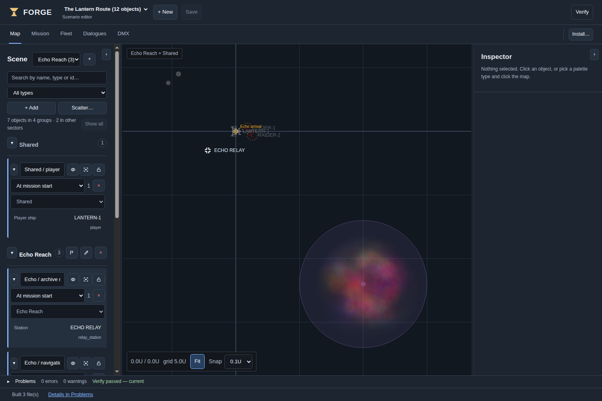
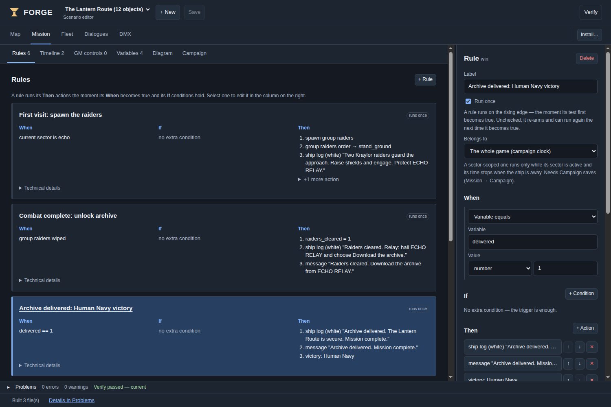
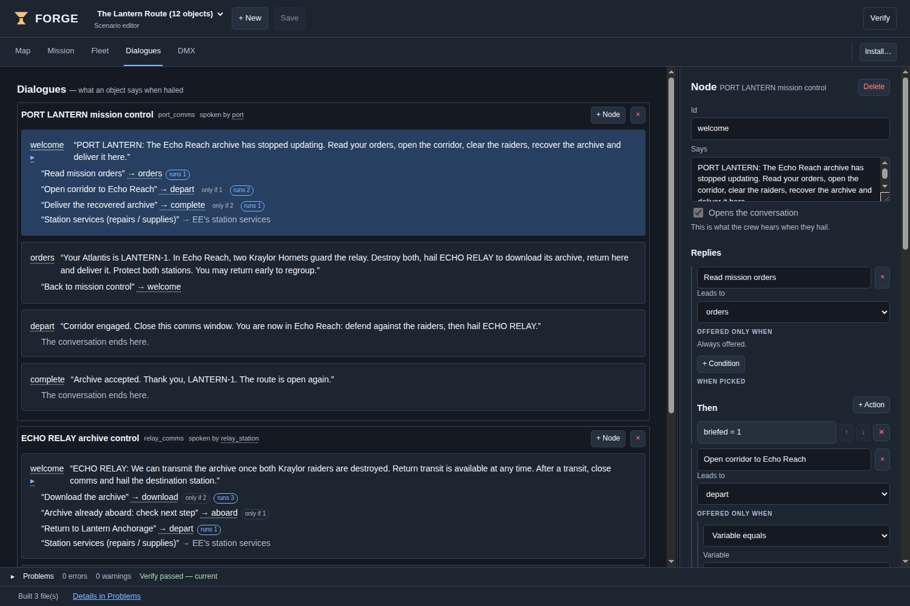
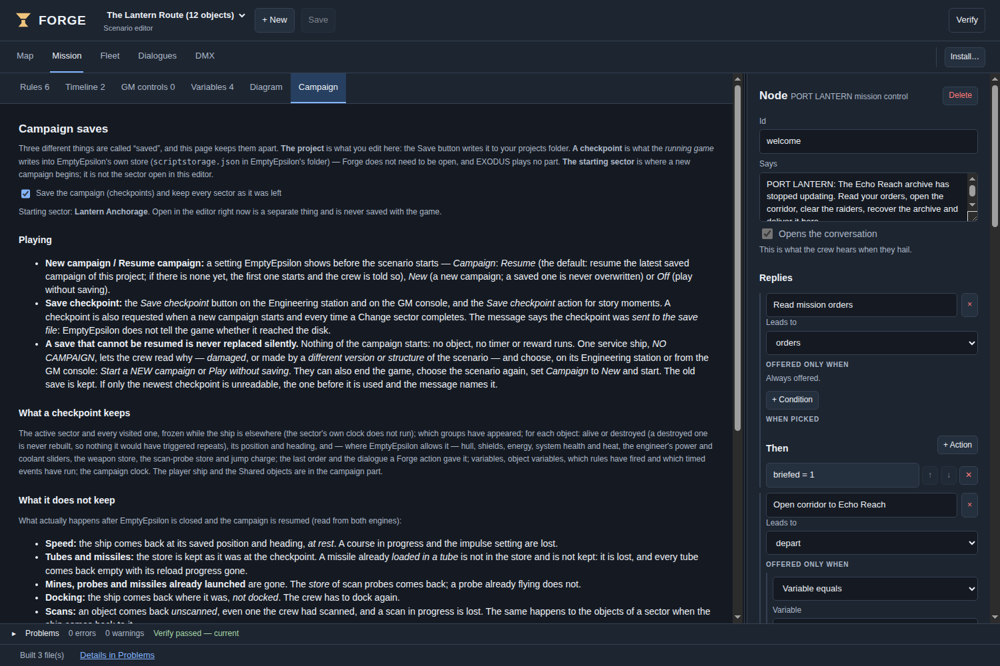

# Start here

This guide is for **Forge 0.9.0**, with its English interface and project format 5. It teaches the authoring workflow using **The Lantern Route**, the editable mission included with this guide. No programming knowledge is required for the main workflow.

The target engines in this edition are **EmptyEpsilon 2024.12.08** and **EmptyEpsilon 2026.09.22PR**. Use the matching export. A later prerelease needs its own compatibility check.

**Forge creates scenarios. EmptyEpsilon runs them.** You can close Forge before playing. Vanilla exports do not require EXODUS, its bridge, a web browser or an HTTP server. Screenshots in this guide show Forge's browser edition; the desktop edition adds native file and installation controls.

If you only want to play the example, start with `START-HERE.md` in the pack. If you want to create your own mission, work through chapters 1–8, then verify and export it using chapter 10.

# 1. Set up your workspace

## Register the right engine

Open Forge. In the desktop application, open **Settings** to choose your projects folder, and **Installations…** to register the folder containing your EmptyEpsilon executable. Scan the installation so Forge can offer its ship templates, factions and assets. This reads the installation; it does not launch a game.

Select the installation you intend to use. A recognised version means Forge matched a known engine reference; it is not a guarantee about every modified resource in that folder. Rescan after changing engine content. If you keep two installations of the same version, select the intended one explicitly.

You do not need to run EXODUS. Leave its optional extension disabled for this guide.

## Import the teaching example

1. Choose **Import…**.
2. Select `projects/2024/lantern_route/project.json` or `projects/2026/lantern_route/project.json` from the pack.
3. Import it as a copy into your workspace.
4. Open **Map** and select **Lantern Anchorage** in the sector selector.
5. Choose **Verify**. Read any problems before exporting.

Both variants use the id `lantern_route`. Keep them in separate workspaces when you want to compare them, or let the import workflow create a distinct copy. Do not overwrite one with the other by manually copying folders together.

The project document is the editable source. Back up the whole project folder before experimenting. Generated Lua is an output: editing it does not update Forge, and the next build replaces it.

## Start a new project

Choose **New**, enter a meaningful mission name, and save. A starter includes a group and a player ship. Keep exactly one player ship while learning this workflow. First make a small scenario work; then add more objects and story branches.

Do not confuse the selected installation with a change to the project's target. The editor does not provide a general in-place project retargeting workflow. Use Export's target choice for target-specific bundles, or the supplied matching project variant for this example.

# 2. Know what each command does

| Command | Result | Does it put a scenario in EE? |
| --- | --- | --- |
| **Save** | Stores the editable project document | No |
| **Verify** | Generates and checks the scenario; reports problems | No |
| **Export…** | Writes distributable output for your chosen target(s) | No |
| **Install scenario** | Previews and copies files to a selected EE installation | Yes, after the install workflow |
| **Save rig** | Stores the separate DMX lighting document | No scenario save |
| **Save checkpoint** in EE | Requests a campaign-state write during play | No change to the Forge project |

The main views are **Map**, **Mission**, **Fleet**, **Dialogues** and **DMX**. The bottom status area reports operations; the Problems area collects issues and can take you to their source. A successful Verify becomes out of date after you change the project. Verify again before distributing.

Unsaved changes have a marker. When leaving a document, use **Save**, **Don't save** or **Cancel** deliberately. A DMX rig and a scenario are different documents: saving one does not save the other.

# 3. Build and edit the map

## Place, select and move

The Scene column lists groups and their objects. **+ Add** opens the palette; choosing a type arms placement. Click on the map to place it. Cancel or press **Esc** when finished. **Scatter…** places a seeded field or cluster, useful for asteroids; inspect the preview before committing.

Click a scene row or map object to select it. Ctrl/Command-click scene rows adds or removes objects from the selection. On the map, left drag moves objects or draws a selection rectangle on empty space; right drag pans. The wheel zooms about the cursor. Use the visible selection before pressing Delete.

**Esc** without a reference-picking operation stays on Map and clears/disarms the current map interaction. During a reference pick started elsewhere, Esc cancels that pick and returns to the originating view.

Use Snap for deliberate placement. Coordinates follow EE: x increases right, y increases down. Map labels use U; **1 U = 1,000 game units**. Rotation is not compass heading: an authored rotation of **0 degrees points right/east**. Set it explicitly when the starting orientation matters.

## Use the inspector

Select an object and edit the relevant section: **Identity**, **Position & shape**, **Behavior**, **Story**, **Appearance** or **More**. The available fields depend on the object type.

An **id** is the project's reference, such as `relay_station`. A **callsign** is what the crew recognises, such as `ECHO RELAY`. They do not need to match. Rename ids through Forge so references are updated. Repeated callsigns are allowed; the Scene list shows ids to distinguish them.

**Used by** lists rules, dialogues and other content that reference the selection. Follow a reference to inspect its use, then return to Map. Before deleting, review references and the confirmation. Removing a group also removes its member objects.

Search and type filters change the Scene list, not the mission. If a selection is hidden by a filter, clear the filter to see it. Collapse Scene or Inspector when you need more map space on a small screen.

# 4. Organise sectors and groups

Think of a **sector** as a location, a **group** as a set of objects that appear together, and an **object** as one ship, station or hazard. A group is not a folder of nested subgroups.

## Editing visibility versus gameplay

Choose a sector to edit it without overlapping other locations. **All sectors** shows everything, so two locations built at the same coordinates overlap. Visibility and lock controls help you edit; they do not destroy objects, delay their appearance in the game or change the active game sector.

A group's appearance setting is separate: **At mission start** or **When spawned**. For the latter, add a **Spawn group** action. Merely drawing a group in the editor does not schedule it.

## Make travel happen in the game

1. Create your sectors and assign their groups.
2. Choose the game's starting sector using the flag button beside the sector in Scene (tooltip: **Start the game in …**).
3. Put the player ship in **Shared**, as this example does.
4. Add an arrival marker to each destination sector.
5. Add a **Change sector** action to a rule or dialogue reply. Select the destination, its arrival marker and the desired rotation.

With a game start sector chosen, only that sector's start groups and Shared start groups initially appear. Shared groups are not unloaded during travel. A Change sector action keeps the player ship and relocates it to the arrival marker. A marker is an authoring reference, not a physical beacon in EE.

**Current sector is** lets a rule check the active game location. It does not itself move the ship. Likewise, the ship's normal jump drive only changes its position within the current game world; it does not select a Forge sector.

Use Change sector to unload a location. Do not emulate it with **Destroy group**: genuine destruction can satisfy **Group wiped out** and trigger rewards or victory. Proper sector unloading is distinguished from a kill.

## Revisit behaviour

Enable campaign saves to use frozen sector state. Objects destroyed there stay destroyed, surviving objects restore the supported saved properties, and sector-local progress resumes. A sector does not simulate while you are away.

With campaign persistence disabled, revisited sectors are rebuilt from their initial object definitions rather than retaining a full sector snapshot. Test your rules with that mode if you intend to use it. Do not assume an editor visibility setting chooses either behaviour.

# 5. Write the mission with rules and events

Open **Mission**. Use **Rules** for conditions, **Timeline** for timed events, **Variables** for progress, **Diagram** for an overview and the **Logic simulation** panel for a logic rehearsal. **Campaign** controls persistence.

## Understand a rule

A rule reads: **When this happens, and these additional conditions are true, do these actions.** Actions execute in their listed order.

Rules trigger when their combined condition changes from false to true. With **Run once** enabled, that rule will not run again. Turning Run once off does not mean "repeat every frame": the condition must become false and then true again to re-arm.

A group that has never appeared is not considered wiped out. A group unloaded by Change sector is not considered killed. A normal **Destroy** action really destroys its targets and can satisfy destruction conditions.

## Variables in human terms

A variable remembers a fact: `archive = 0` means the archive is not aboard; `archive = 1` means it is. Declare its initial value in Variables, set it with **Set variable**, and test it with **Variable equals**.

Types matter. Number `1`, text `"1"` and boolean `true` are different values. The example consistently uses numbers 0 and 1. **Declare** helps create a missing declaration from use, but review the inferred type and initial value.

Object variables belong to particular objects; global variables belong to the whole mission. Use a global variable for campaign-wide milestones.

## Recipe: victory after delivery

In the example, the port's delivery reply sets `delivered` to `1`. Open rule **Archive delivered: Human Navy victory**:

- **When:** Variable equals → `delivered` → numeric `1`.
- **Run once:** enabled.
- **Actions:** write a ship-log entry, show a global message, then **Victory → Human Navy**.

Victory names the winning faction. Do not award victory merely because the archive was downloaded if the objective also requires returning home.

## Recipe: defeat if a protected object is destroyed

Add a rule with **Object destroyed** pointing to the player or protected station. Add a failure message and **Victory → Kraylor** (the opposing faction in this example). There is no need for a separate invented defeat action: awarding victory to the opposition ends the player's mission as a loss.

Test each loss condition, not only the win. Avoid competing win and loss conditions that can both become true in the same update; action order should not decide your story accidentally.

## Timed events and sector clocks

A Timeline event runs at its configured time. **Belongs to: Global** uses campaign time. An event belonging to Echo Reach uses only the time spent in Echo Reach when persistence is enabled; that clock freezes elsewhere.

Adding a **Current sector is Echo** condition to a global rule does **not** give it a local clock. Choose the scope explicitly. The example's reminder belongs to Echo and occurs after 90 active seconds there.

## Messages and GM controls

Use **Ship log** for instructions the crew can reread, and **Global message** for a brief announcement. Keep the announcement short; EE station banners can clip long text. **Banner** is not an ordinary crew-visible message in EE; read the action's warning.

GM buttons are useful for manual scenario control, but make any required GM involvement explicit in the player instructions. The Lantern Route needs none.

## What Simulation proves

Simulation runs the mission logic against a virtual clock and events you supply, such as a destroyed object. It does not fly ships, balance weapons, provide a real comms player or render EE. Read its "not simulated" notes.

Use it to test premature victory, loss rules and timer order. Then play in the real target engine. A successful logic rehearsal is not proof that the enemy can be reached or that the crew can find the right dialogue reply.

# 6. Build conversations the crew can use

Open **Dialogues**. A dialogue contains **nodes** (what a character or station says) and **replies** (what the crew can choose). Select an entry node. Replies can lead to another node, run actions, or hand off to stock services or the GM.

## Create and attach a conversation

1. Create a dialogue with a clear id and label.
2. Add an entry node with a short instruction.
3. Add replies and their destination nodes.
4. Add a Back reply where the crew should be able to return.
5. Select the station on Map and assign the dialogue in its Story properties.
6. Verify, export and hail the station in EE.

A dialogue that exists but is not attached to an object cannot be discovered by hailing that object. A node with no replies ends that branch; the player closes comms normally.

## Conditional replies and actions

The example's **Download the archive** reply requires `raiders_cleared = 1` and `archive = 0`. Its actions set `archive = 1`, write the next instruction and request a checkpoint.

A reply whose condition is false is **absent**, not greyed out. Tell players what they must accomplish in the node text so they do not mistake a missing reply for a broken interface.

After a Change sector reply, explicitly tell the crew to close the old comms window and hail the destination station. The old station is being unloaded; its conversation should not be used as the new station's menu.

## Preserve station services

Attaching a custom dialogue replaces the station's usual service conversation. Add a reply targeting **EE's station services** if you want to retain repair, supply and other stock options. Their availability and costs remain governed by EE. Once in the service menu, close comms and hail again to return to your story dialogue.

# 7. Work with ships in Fleet

**Original ships** come from the selected EE installation and are read-only. **Project templates** belong to your project. A ship object on Map is an instance that references a template.

Select an original and choose **Copy into project** to make an editable template. Review the offer to move existing instances to it: copying and reassigning are separate decisions. Duplicating a project template does not automatically move instances.

Fleet sections are **Identity**, **Hull**, **Movement**, **Weapons** and **Interior**. **Search properties** finds a field and opens its section without changing its value. **Used by** shows the map instances that use the template.

Use firing-arc previews beside weapon settings and the deck plan beside rooms and doors. Numeric fields remain the precise alternative. A 3D stand-in is not proof that the selected EE model is available. Resource status distinguishes **Found**, **Not found**, **Not checked**, **Stand-in** and **Other source**. A missing resource name is kept visible rather than silently replaced.

Custom templates and models require launch-time installation in EE and a restart. Let Forge's install preview explain the extra files and changes. The Lantern Route deliberately uses stock Atlantis, MT52 Hornet and Small Station templates, so its export is only three drop-in Lua files.

# 8. Campaign saves and their limits

Enable saves in **Mission → Campaign**, and set a starting sector. A saved campaign includes mission variables, supported object properties, destroyed-object records, visited-sector state, and rule/timer progress.

## The three start modes in EE

| Campaign setting | Meaning |
| --- | --- |
| **New** | Start a fresh campaign beside existing saves |
| **Resume** | Try the latest campaign for this project; a truly empty history starts a first campaign |
| **Off** | Play without writing campaign checkpoints |

For the first intentional run of this example, select **New** explicitly. Resume is the generated default. New does not overwrite an older campaign, but the interface is not a browser for selecting arbitrary older campaigns.

Checkpoint requests occur at campaign start and around sector transitions. You can also add **Save checkpoint** as an action or press the in-game Engineering/GM checkpoint button. The archive download in this example requests one.

## Where the save lives

The host engine writes its `scriptstorage.json`; saves are not stored in the Forge project or distributed Lua files. All clients depend on that host's save. Keep the same scenario version and EE target when resuming. Structural project changes or a different engine can make a checkpoint incompatible.

The engine's storage API cannot confirm a successful physical disk write. A message saying a checkpoint was **sent to the save file** means a write was requested. It is not a guarantee against permissions errors or disk failure. Close and restart the host to check a real resume.

## What comes back, and what does not

| State | Resume/revisit expectation |
| --- | --- |
| Destroyed authored objects | Stay destroyed with persistence enabled |
| Supported surviving-object properties | Restored from the recorded state |
| Global variables and scoped progress | Restored |
| Inactive sector timers | Frozen until that sector becomes active |
| Player velocity after restart | Ship starts at rest |
| Loaded missile tubes after restart | Empty; a loaded round is lost, not refunded to inventory |
| Launched missiles, mines and probes | Not restored |
| Probe inventory | Restored |
| Docking after restart | Ship is undocked |
| Scan knowledge | Reset, including on sector revisit |
| Alert, shields up/down, beam frequency, selected target after restart | Engine defaults; inspect controls before combat |
| Engineering power/coolant requests | Restored through player control requests |
| Objects created outside the authored map | Not part of the persisted object set |

During a sector jump within a running game, the player remains the same ship and keeps tactical controls; restarting reconstructs it. Neither mode is a complete save of everything in EE.

## If Resume cannot continue

An unusable checkpoint is not silently replaced with a new game. You may see a holding ship named **NO CAMPAIGN**. Select it and read its log. Engineering offers **Start a NEW campaign** or **Play without saving**, depending on what is recoverable; a damaged campaign index can restrict the choice to unsaved play. Alternatively end the game and choose Campaign = New when appropriate.

Two internal slots can recover some interrupted or damaged checkpoints, but both are in the same file. They are **not independent backups**. Whole-file corruption can appear to the engine as an empty history.

With EE closed, make a dated copy of `scriptstorage.json` before updating scenarios or engines. Forge's distribution includes a separate optional **Save backup tool**; read its own instructions. It validates the JSON copy, not every campaign's playability. Restoring that file affects other scenarios' stored keys too. Never include your personal save in a community mission ZIP.

# 9. Optional DMX lighting

The DMX view edits a lighting rig, a separate document that produces `hardware.ini` for EE's hardware integration. Save it using **Save rig**. It is not a requirement for normal scenarios and it is not the campaign save system.

Define fixtures and channels, then effects and mappings to game triggers. Preview before installing and check against the actual fixture's channel layout. A software preview is not evidence that physical lighting hardware works. The community example contains no rig and does not require a DMX controller.

# 10. Verify, export, install and play

## Before every release

1. Save the project.
2. Choose **Verify** and inspect the Problems area.
3. Fix errors; read warnings rather than suppressing them by habit.
4. Follow a problem's location to correct its field or reference.
5. Verify again after changes so the result is current.

Stock-template warnings can indicate an absent or wrong installation scan. Register the matching engine and rescan. Do not change a valid ship name just because another engine's list is showing.

## Export for both targets

Choose **Export…**, select vanilla, and select 2024, 2026 or both. Both produces two independent bundles, built against the matching catalogs. Keep the target folders labelled when sharing. Export success does not test the generated mission inside either engine.

For this pack, copy the three `.lua` files from the matching `play/<year>/scripts/` folder to EE's `scripts` folder. The scenario picker reads `scenario_lantern_route.lua`; the other two files must be alongside it. Do not copy only the scenario entry file.

For projects with custom templates/models, manual copying requires additional launch-time steps. Prefer **Install scenario**, review its plan, and follow any restart requirement. Check the selected destination and any overwrite/collision notice. Do not change files that belong to someone else's scenario to make a collision disappear.

A file can be held open by another program. If installation reports **HELD OPEN**, release the file and retry. The fact that EE is running is not by itself proof that it holds a scenario file locked.

## Playtest checklist

- Start a new game in each target engine, using a copy of your work.
- Can the crew recognise the objective without an author explaining it?
- Does the first conversation offer the correct next action?
- Do enemies spawn only when intended, and can weapons reach them?
- Does each intended victory and defeat actually end the game?
- Can the crew return early without earning false rewards?
- Does returning to a saved sector retain supported damage and progress?
- Does a checkpoint survive a real host-process restart?
- Are service menus reachable and instructions visible in the ship log?

Use `verification/TEST-REPORT.md` for the evidence attached to this particular pack. Do not treat test results from another project or earlier draft as results for your export.

# 11. Learn by modifying The Lantern Route

Use an imported copy. Start with these small changes and test after each one.

**Exercise 1 — a clearer briefing.** Edit the port's welcome node. Save, Verify, export and hail the station in EE. Confirm the new text appears. This teaches the source-to-game loop.

**Exercise 2 — a third raider.** Add a stock enemy to the `raiders` group. Keep that group's spawn mode and rule unchanged. The group-destroyed objective now includes the new member. Test combat balance; adding an enemy is not merely cosmetic.

**Exercise 3 — a flag-controlled destination.** Add a numeric variable `access_granted`, initially 0. Make a dialogue reply set it to 1. Add a new Change sector reply that requires that value. Its text should tell the player why the route is unavailable before authorisation.

**Exercise 4 — a local reminder.** Inspect `echo_reminder`, which belongs to Echo Reach. Leave before its local 90-second threshold, spend time at home, then return. Compare with a global event. A sector filter in Map is not the same thing as event scope.

**Exercise 5 — an alternate ending.** On a copy, add a different final objective and a matching winning-faction action. Ensure the old delivery victory cannot fire first. Test both intended success and failure.

Start a new campaign after structural edits. Keep an unmodified copy of the original example for comparison.

# 12. Troubleshooting and quick reference

| Symptom | Check first |
| --- | --- |
| Scenario absent from EE's picker | Correct scripts folder, entry filename and matching export; all three files copied |
| Station shows only stock services | Dialogue assigned to the station object, not merely created in Dialogues |
| Download reply absent | Both raiders truly destroyed; correct station; archive not already aboard |
| Archive downloaded but no victory | Return to PORT LANTERN and explicitly deliver through comms |
| Enemy never appears | Group set to spawn by rule, rule reached, destination sector active |
| Victory happens too early | Ending condition, initial variable type/value, genuine Destroy actions |
| Two maps overlap in Forge | All sectors selected; choose one sector to edit |
| Hidden objects still appear in EE | Editor visibility does not control gameplay |
| Travel changes position but not location | Normal ship jump used; use the authored Change sector interaction |
| Old conversation remains after transit | Close comms and hail the destination station |
| Ship template list wrong or empty | Target/installation selection and scan; rescan after engine changes |
| 3D ship looks generic | Check resource status; a stand-in is not the selected model |
| Verification marked out of date | Re-Verify after edits |
| Resume shows NO CAMPAIGN | Read the holding ship's log; choose recovery/new/unsaved intentionally |
| Restart loses loaded missiles or scan data | Documented save limits, not a complete EE snapshot |

**Authoring:** Save document → Verify → Export/Install → play in EE.

**Mission logic:** event/condition → actions → changed world or variable → later rule.

**Travel:** select a game start sector → assign groups → place arrival markers → Change sector.

**Persistence:** enable campaign saves → choose New/Resume/Off in EE → request checkpoints → verify after restart.

For the full example solution and the exact variable sequence, read `WALKTHROUGH.md`. For the measured checks and remaining limits, read `verification/TEST-REPORT.md`.
